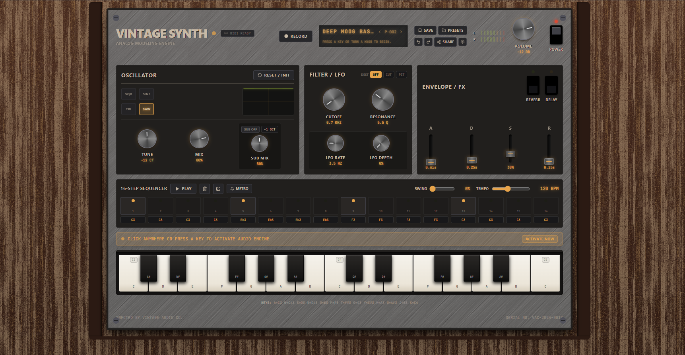

# Vintage Synth

> A professional-grade, browser-based skeuomorphic virtual synthesizer. Featuring authentic analog modeling, drift-free step sequencing, and expressive Web Audio synthesis with full MIDI hardware integration.

---

## Overview

**Vintage Synth** is a professional-grade analog modeling synthesizer that runs entirely in your browser. Built with modern web technologies (React 19, TypeScript, Web Audio API), it delivers authentic sound synthesis, real-time performance control, and seamless hardware integration—all with zero installation required.

Whether you're composing music, designing sounds, or exploring synthesis, Vintage Synth provides the tools and tactile interface of hardware synthesizers, accessible from any device.

**[🎹 Play Now](https://vintage-synth.app)** • **[GitHub](https://github.com/Arthurs-excalibur/Analog-Music-Studio)** • **[Documentation](#documentation)**

---

## 🖼️ Preview



A fully-featured synthesizer with authentic hardware controls: ADSR envelope, resonant filter, step sequencer, oscilloscope visualization, and expressive 25-key keyboard interface.

---

## 🎯 Key Features

### 🎛️ Authentic Hardware Interface
- **Walnut wood enclosure:** Dark walnut wood grain side panels and recessed chassis borders.
- **Machined metal controls:** Conic-gradient rotary knobs with tactile drag manipulation, double-click defaults, and keyboard adjustments.
- **Backlit amber LCD screen:** Dynamic patch name, slot index (`P-001`), and real-time parameter feedback with phosphor glow.
- **Dual stereo VU meters:** 8-segment L/R LED meters (green → amber → red clip thresholds) calculated from live RMS audio analysis.
- **CRT Oscilloscope:** Real-time canvas oscilloscope visualizing active waveforms with reticle grid lines.
- **Tactile keybed:** 25-key ivory and ebony piano keys with mechanical depression and active voice lime illumination.

### 🔊 High-Fidelity Synthesis Engine
- **Waveforms:** Square, Sine, Triangle, and Sawtooth.
- **Pitch & Tuning:** Fine detuning (cents) and oscillator mix controls.
- **Resonant Low-Pass Filter:** Cutoff frequency (40 Hz – 16 kHz) and Q resonance control (0.1 – 18).
- **ADSR Envelope:** Independent Attack, Decay, Sustain, and Release vertical sliders.
- **Stereo Effects:**
  - Convolution reverb with custom-generated algorithmic impulse responses.
  - Feedback delay with wet/dry and safe limiter constraints.
- **Multi-voice polyphony:** Dynamic voice allocation with anti-pop gain ramps.

### 🎵 Drift-Free 16-Step Sequencer
- Lookahead Web Audio clock scheduling immune to UI rendering lag or background tab throttling.
- Per-step active LED toggle and per-step note pitch assignment (`C3` to `C5`).
- Variable tempo control (50 – 200 BPM) and instant pattern clearing.
- Automatic persistence to `localStorage`.

### 💾 Sound Banks & Persistence
- **5 Built-in Factory Presets:**
  - `INIT PATCH`: Clean initial template.
  - `DEEP MOOG BASS`: Punchy analog low-end with low cutoff.
  - `WARM RETRO PAD`: Soft attack, wide resonance, convolution reverb and delay.
  - `ACID RESO LEAD`: Screaming resonant square lead with feedback delay.
  - `ANALOG CHIME PLUCK`: Fast attack with chime-like decay.
- **User Preset Management:** Save customized patches with user-defined names, reload instantly, and delete custom entries.
- **Local Browser Storage:** All settings and sequencer patterns survive page reloads without external backend requirements.

### ⚙️ Advanced Modulation & Sound Design
- **Sub-Oscillator Layer:** Independent sine sub-generator switchable between -1 octave and -2 octaves with dedicated mix level control.
- **LFO Modulation Matrix:** Dedicated Low-Frequency Oscillator (0.1 Hz – 20 Hz) with variable depth routed to either filter cutoff frequency (auto-wah) or pitch detuning (vibrato).
- **Sequencer Swing & Metronome:** MPC-style swing shuffle (0%–60%) for rhythmic groove and optional audio metronome click on downbeats.
- **Parameter Undo & Redo History:** Full history stack supporting `Ctrl+Z` (Undo) and `Ctrl+Y` / `Ctrl+Shift+Z` (Redo) with dedicated toolbar buttons.
- **URL Hash Patch Sharing:** Encode any patch to a portable URL `#patch=<base64>` for instant one-click preset sharing with no backend required.

### 🎚️ Live Recording & Hardware Integration
- **Live Performance Recording:** Dedicated `RECORD` button on the front panel with pulsating red tally lamp. Captures real-time master output and triggers automatic audio file download upon completion.
- **Web MIDI Controller Support:** Plug-and-play USB/Bluetooth MIDI keyboard detection. Displays connected controller name on the LCD status header (`MIDI: ARTURIA KEYSTEP`) and scales velocity.
- **Preset & Pattern Archive:** Export and import custom patches and sequencer patterns as `.json` with strict schema validation.

---

## 🎹 Computer Keyboard Mapping

| Key | Musical Note | Frequency |
|:---:|:---:|:---:|
| `A` | C3 | 131 Hz |
| `W` | C#3 | 139 Hz |
| `S` | D3 | 147 Hz |
| `E` | D#3 | 156 Hz |
| `D` | E3 | 165 Hz |
| `F` | F3 | 175 Hz |
| `T` | F#3 | 185 Hz |
| `G` | G3 | 196 Hz |
| `Y` | G#3 | 208 Hz |
| `H` | A3 | 220 Hz |
| `U` | A#3 | 233 Hz |
| `J` | B3 | 247 Hz |
| `K` | C4 | 262 Hz |

---

## 🚀 Getting Started

### Prerequisites
- Node.js `v18+` or `v20+` (tested on Node v25)
- npm or pnpm

### Installation
```bash
# Clone or navigate to the repository
cd "Analog Music Studio"

# Install dependencies
npm install
```

### Running Locally
```bash
npm run dev
```
Open your browser at `http://localhost:3000`.

### Running Automated Tests
```bash
npm run test
```

### Production Build
```bash
npm run build
```
Generates a static web bundle in `dist/` ready for hosting on GitHub Pages, Vercel, Netlify, or any static HTTP server.

---

## 📋 Specifications

| Category | Details |
|----------|---------|
| **Polyphony** | 8-voice dynamic allocation |
| **Waveforms** | Sine, Square, Triangle, Sawtooth + Sub-Osc |
| **Filter Type** | Resonant 12dB/octave Low-Pass |
| **Frequency Range** | 20 Hz – 20 kHz |
| **Sequencer** | 16-step drift-free Web Audio clock |
| **Tempo Range** | 50 – 200 BPM |
| **MIDI Support** | Web MIDI API (plug-and-play hardware) |
| **Audio Export** | WAV format, lossless |
| **Preset Slots** | 5 factory + unlimited user presets |
| **Browser Support** | Chrome, Firefox, Safari, Edge (modern versions) |

---

## 🛠️ Technology Stack

- **Frontend:** React 19, TypeScript, Tailwind CSS
- **Audio Engine:** Web Audio API (native browser synthesis)
- **Build Tool:** Vite v6
- **Testing:** Vitest, React Testing Library
- **State Management:** React Hooks + localStorage
- **Hardware Integration:** Web MIDI API

---

## 🎼 Sound Design Tips

- **Fat Bass:** Use the sub-oscillator at -2 octaves with high mix level
- **Warm Pad:** Combine sawtooth + square with high filter resonance and convolution reverb
- **Acid Lead:** Modulate filter cutoff via LFO and use feedback delay for thickness
- **Punchy Drums:** Short attack, fast decay with high filter cutoff

---

## 📄 License

This project is licensed under the MIT License. See the [LICENSE](./LICENSE) file for details.

---

## 🤝 Contributing

Contributions are welcome! Please feel free to submit a Pull Request or open an Issue for bug reports and feature requests.

---

## 📞 Support

For issues, feature requests, or questions, please visit the [GitHub Issues](https://github.com/Arthurs-excalibur/Analog-Music-Studio/issues) page.

---

**Built with ❤️ for music makers, sound designers, and synthesis enthusiasts.**